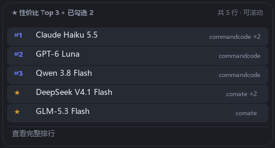
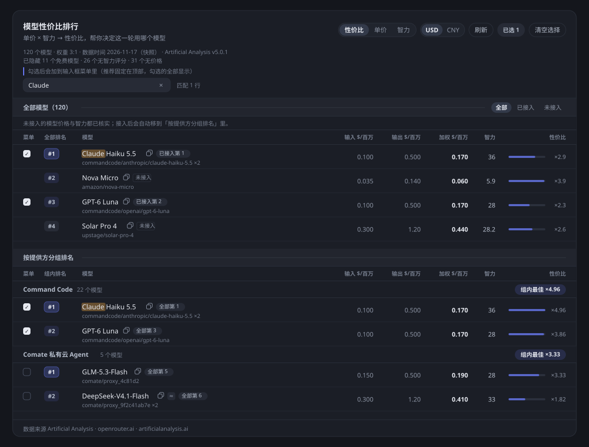

# dsh-model-value

[](https://github.com/znshmily/dsh-model-value)
[](./LICENSE)
[](https://github.com/znshmily/dsh-model-value/stargazers)
[](https://github.com/deepseek-ai/deepseek-harness)

**English** · [中文](./README.zh.md)

Know what a model costs before you pick it. This plugin ranks every model your DeepSeek Harness host already has by **unit price**, **intelligence**, and **value for the money** — and puts the answer where you actually choose a model: the composer's model menu.

| Composer model menu | Ranking panel |
| --- | --- |
|  |  |

## What it does

- **Best-value picks in the model menu.** Three rows above the list, one per distinct model, picked by value. Pinned models follow with a ★. One click switches the session.
- **A ranking panel with two questions on one page.** "Which model is worth it overall?" and "Which model is worth it on *this* provider?" — the same table, two numberings.
- **Models you have not connected yet.** Priced and scored market models are listed alongside, ranked on the same scale, so you can see what a different provider would buy you.
- **An agent tool.** `model_value_rank` returns the same data to the model itself, so it can ask "what is cheap and good right now?" before choosing.

## Install

```sh
dsh plugin add dsh-model-value                     # npm
dsh plugin add github:znshmily/dsh-model-value     # GitHub source
```

Or from the **Plugins** page of the DSH Desktop app / the Discover tab of the plugin market. A local checkout installs with the plugin manager (`install_bundle <path>`) — never edit the profile's `package.json` or `cordis.patch.yml` by hand.

Reload the session (or refresh the page) afterwards: the model menu gains a "★ Top 3 by value" block whose last row opens the full ranking.

## Using it

**The menu** answers one question — *which channel's which model do I switch to*. Each row is a rank, the full model name (it wraps rather than truncates), and the provider that would serve it. Price and intelligence live in the panel; nothing is hidden behind a tooltip.

**The panel** has two blocks in one scroll container:

- **All models (N)** — connected channels and market models in a single table with one numbering. The scope chips narrow it to connected or not-connected; the title and count follow.
- **By provider** — the connected channels again, each with its own 1..N ranking, because "best on this provider" and "best overall" are different questions.

Both numberings stay visible: the rank column shows the one the table is sorted by, and a pill next to the name spells out the other. Headers and group titles stick while you scroll. The model cell is two lines — the name with its pills, then the raw `provider/model` id, which you can select and copy (that is where a provider's opaque `proxy_<hash>` shows up). A **name search** highlights matches without filtering anything, so ranks, order and checkboxes stay put. Every text is selectable, and each row has a copy button for the model name.

**Pinning** a row (the checkbox column) adds that channel's model to the menu after the Top 3. Pins are per channel instance — the same underlying model on two providers is two rows, and ticking one does not tick the other. The list is global and persists in the Host's `state.json`.

## How the ranking is computed

Everything runs on the Host; the client only renders. Both the panel and the tool read one endpoint, `/dsh-model-value/api/rank`.

```
effectiveInput = input × (1 − cacheHitShare) + cacheRead × cacheHitShare
blended        = effectiveInput × wIn + output × wOut        (weights normalised, default 3:1)
value          = intelligence / blended                      (index points per $/M tokens)
```

- `cacheRead` only applies to models with a published cache price; the rest pay full input. `cacheHitShare` defaults to 0.5.
- Weights default to 3:1 input:output — coding sessions read far more than they write. Both zero falls back to 1:1.
- **Free, unpriced and unscored models are not ranked.** A free model has no finite value, and a missing score is not a low score; they are counted in the header line instead of being sorted next to real numbers.
- `≈` on a price or a score means it was **derived** (inherited from the base serving tier, or from the parent model) rather than published. Hovering the badge says where it came from.
- The value bar is normalised to the median of its own table, so `×4.96` reads as "about five times the median value **here**" — the two blocks have separate medians and are not comparable to each other.

## Configuration

Settings → Plugins → Plugins configuration → **Model value** (`weightInput`, `weightOutput`, `cacheHitShare`, `currency`, `fx`, `includeFree`, `onlineRefresh`, `overridesJson`).

| Field | Default | What it does |
| --- | --- | --- |
| `weightInput` / `weightOutput` | `3` / `1` | Input:output weights of the blended price. |
| `cacheHitShare` | `0.5` | Share of input tokens billed at the cache-read price. |
| `currency` / `fx` | `USD` / `7.2` | Display currency; the table itself is stored in USD per million tokens. |
| `includeFree` | `true` | Show zero-price replicas as their own group. |
| `onlineRefresh` | `true` | Pull live prices from OpenRouter; failures fall back to the bundled snapshot silently. |
| `overridesJson` | `""` | Hand overrides, e.g. `{"models":{"vendor/model":{"input":0.3,"output":1.2}},"scores":{"vendor/model":48}}`. |

## Data

Bundled snapshot: **509 price entries** and **176 intelligence scores** (155 measured, 21 derived) from the **Artificial Analysis Intelligence Index v5.0.1**, prices as of **2026-11-17**.

- Prices: the OpenRouter catalogue; intelligence: Artificial Analysis, via the public [aiapiindex.com](https://aiapiindex.com) mirror (CC BY 4.0). `npm run sync` (`tools/sync-sources.mjs`) re-syncs, `tools/fill-gaps.mjs` covers models the mirror has not caught up with.
- `tools/seed-market.mjs` regenerates the market-model seed used by the panel.
- The only outbound request the plugin makes is the optional OpenRouter price refresh. There is no telemetry, and no data leaves your machine otherwise.

**The snapshot only changes with a release** — nothing at runtime rewrites `data/*.json`. So the panel names where its numbers came from: `Data as of 2026-11-17 (snapshot)` until you press **Refresh**, then `Data as of 2026-11-21 (online, 40 models)`, because the refresh replaces prices for the keys OpenRouter still lists and waits for them before answering. A refresh that fails on every key keeps the snapshot date and says so (`online refresh failed (9)`).

Intelligence refreshes the same way, from its own feed: the Artificial Analysis index is re-read from the public mirror (about 130 scored models, matched onto rows the table already has — a refresh never invents a model), dated separately, and shown as `scores as of 2026-11-21 (online, 108)` whenever it differs from the price date. Both fetches run in parallel and fail independently: one half can be online while the other stays on the snapshot, and the footer warning says which half failed. Online data lives in memory only: restart the host and you are back to the snapshot, which is the point — refresh when you want fresher numbers, otherwise the bundled data is what you get.

Snapshot data can be wrong, and providers change prices without notice — treat the numbers as a shopping aid, not a bill.

## Development

```sh
node test/units.mjs      # key matching, blended price, sorting, groups, payload, pins, tool, select route
node test/client.mjs     # headless render of the real client bundle (13 scenarios)
node --check index.js && node --check client.js
```

The panel and menu previews are drawn from the same geometry the stylesheet declares, so documentation cannot drift from the UI: `tools/preview.py` → `docs/preview.svg`, `tools/preview_menu.py` → the menu image, `tools/make_icon.py` → the storefront icon (the markets take raster images, not SVG). `screenshots.json` declares the images to the plugin market. `vendor/` carries the Schemastery build, because a bare import of `@deepseek-ai/schemastery` does not resolve from a plugin linked in from outside the profile.

Full notes, including the layout and theme invariants the tests guard: [docs/DETAIL.md](./docs/DETAIL.md).

## License

MIT © [znshmily](https://github.com/znshmily). See [LICENSE](./LICENSE).
