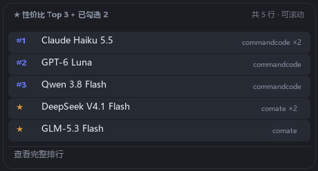
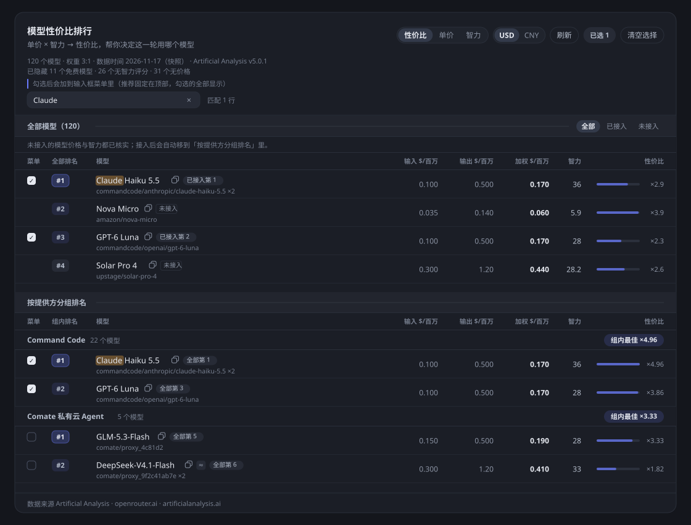

# dsh-model-value

[](https://github.com/znshmily/dsh-model-value)
[](./LICENSE)
[](https://github.com/znshmily/dsh-model-value/stargazers)
[](https://github.com/deepseek-ai/deepseek-harness)

[English](./README.md) · **中文**

选模型之前，先知道它要花多少钱。这个插件给当前 DSH 里已接入的每个模型排名 —— **单价**、**智力**、**性价比** —— 并且把答案放在你真正做选择的地方：输入框上方的模型菜单。

| 模型菜单 | 排行面板 |
| --- | --- |
|  |  |

## 它做了什么

- **模型菜单里的性价比推荐**：列表上方三行，每行一个不同的模型，按性价比挑出来；你在面板里勾选的模型带 ★ 跟在后面。点一下就把当前会话切过去。
- **一张回答两个问题的面板**：「整体上哪个模型划算」和「在这个渠道上哪个划算」——同一张表，两套名次。
- **还没接入的模型也在榜上**：市面模型的价格与智力都已核实，用同一套名次排进去，你能直接看出换个渠道能换来什么。
- **给 Agent 的工具**：`model_value_rank` 把同一份数据交给模型自己，让它在选模型之前先问一句「现在什么又便宜又能打」。

## 安装

```sh
dsh plugin add dsh-model-value                     # npm 包
dsh plugin add github:znshmily/dsh-model-value     # GitHub 源
```

也可以在 DSH Desktop 的 **插件** 页、或插件市场的「发现」页里装。本地目录用插件管理器安装（`install_bundle <path>`）——不要手改 profile 的 `package.json` / `cordis.patch.yml`。

装完重启会话（或刷新页面）：模型菜单顶部会出现「★ 性价比 Top 3」，最后一行「查看完整排行」进入完整面板。

## 怎么用

**菜单**只回答一件事——*切到哪个渠道的哪个模型*。每行是名次、完整模型名（太长就换行，不截断）和会为你服务的提供方。价格与智力在面板里看，没有任何信息藏在悬停提示后面。

**面板**是一个滚动容器里的两块：

- **全部模型（N）**：已接入的渠道实例与市面模型放在同一张表里、共用一个名次。标题条上的范围胶囊可以只看「已接入」或「未接入」，标题和计数跟着变。
- **按提供方分组排名**：已接入的渠道各自 1..N 排名，因为「这个渠道上哪个最划算」和「整体哪个最划算」是两个问题。

两套名次都常驻可见：排名列显示当前排序依据的那个，名字旁边的胶囊写出另一个。表头和分组标题在滚动时吸顶。模型格是两行——名字加胶囊，然后是原始的 `提供方/模型ID`，可以选中复制（Comate 那种 `proxy_<hash>` 就显示在这里）。**按名搜索**只高亮、不过滤，名次、顺序、勾选状态都不变。所有文字都可以选中，每行还有复制模型名的按钮。

**勾选**一行（最左列）会把这个渠道的模型加到菜单 Top 3 之后。勾选粒度是渠道实例——同一个底层模型在两个渠道上是两行，勾一个不会连带另一个。清单是全局的，存在 Host 的 `state.json`。

## 排名怎么算

全部在 Host 侧计算，客户端只负责渲染；面板和工具读同一个接口 `/dsh-model-value/api/rank`。

```
effectiveInput = 输入价 × (1 − 缓存命中占比) + 缓存读价 × 缓存命中占比
加权单价        = effectiveInput × 输入权重 + 输出价 × 输出权重   （权重归一，默认 3:1）
性价比          = 智力分 / 加权单价                              （每 $/百万 token 的分数）
```

- 缓存读价只对收录了缓存价的模型生效，其余按全额输入价计；`cacheHitShare` 默认 0.5。
- 权重默认输入:输出 = 3:1 —— 编码会话读远多于写。两者都为 0 时按 1:1 处理。
- **免费、缺价格、缺智力的模型不参与排名**：免费模型没有有限的性价比，缺分也不等于分低，它们在表头那行被统计出来，而不是混进真实数字里排序。
- 价格或智力上的 `≈` 表示这个数字是**推算**的（继承基础服务档的价格，或取自父模型），悬停胶囊会说明来源。
- 性价比进度条按所在榜单的中位数归一，所以 `×4.96` 的意思是「大约是这里中位数的 5 倍」，两块各有各的中位数，互不可比。

## 配置

设置 → 插件 → 插件配置 → **模型性价比**（`weightInput`、`weightOutput`、`cacheHitShare`、`currency`、`fx`、`includeFree`、`onlineRefresh`、`overridesJson`）。

| 字段 | 默认值 | 作用 |
| --- | --- | --- |
| `weightInput` / `weightOutput` | `3` / `1` | 加权单价里输入、输出的权重。 |
| `cacheHitShare` | `0.5` | 输入 token 里按缓存读价计费的比例。 |
| `currency` / `fx` | `USD` / `7.2` | 显示货币；价格表本身以美元/百万 token 存储。 |
| `includeFree` | `true` | 把零价副本单独成组显示。 |
| `onlineRefresh` | `true` | 向 OpenRouter 拉在线报价；失败时静默回退到内置快照。 |
| `overridesJson` | `""` | 手工覆盖，例如 `{"models":{"vendor/model":{"input":0.3,"output":1.2}},"scores":{"vendor/model":48}}`。 |

## 数据

内置快照：**509 条价格**、**176 个智力分**（155 个实测 + 21 个推算），来自 **Artificial Analysis Intelligence Index v5.0.1**，价格截止 **2026-11-17**。

- 价格取自 OpenRouter 目录，智力分来自 Artificial Analysis，经公开镜像 [aiapiindex.com](https://aiapiindex.com) 同步（CC BY 4.0）。`npm run sync`（即 `tools/sync-sources.mjs`）重新同步快照，`tools/fill-gaps.mjs` 补齐镜像还没跟上的新模型；面板的「刷新」则在运行时读同一份镜像更新已有的键。
- `tools/seed-market.mjs` 重新生成面板用的市面模型种子数据。
- 插件唯一的对外请求是可选的 OpenRouter 报价刷新。没有埋点，除此之外没有任何数据离开你的机器。

**快照只随版本更新** —— 运行时没有任何代码会改写 `data/*.json`。所以面板会写明这些数字是哪来的：没点刷新时是 `数据时间 2026-11-17（快照）`，点过刷新变成 `数据时间 2026-11-21（在线 40 个）`——刷新会替换 OpenRouter 仍在收录的那些键，并且**等抓取完成再返回**，所以一次点击就能看到结果。全部失败时日期不动并显示 `在线更新失败（9 个）`。

**智力分同样可以在刷新时更新**：它走自己那条链路，从 Artificial Analysis 的公开镜像重读榜单（约 130 个有分模型），只更新表里**已有**的键——刷新不会凭空造出一行；日期单独计算，和价格日期不同时显示 `智力 2026-11-20（在线 108 个）`。两次抓取在 Host 侧并行执行、失败互不牵连：可以只有价格是在线、智力仍是快照，底部警告会说明是哪一半失败。一次刷新约 **20 秒**（约 480 个价格请求，并发 12），期间按钮显示「刷新中…」；失败会在表格上方显示错误原文，而且即使正好有别的请求在飞，点刷新也不会被吞掉。刷新结果**会落盘**到 `<DSH_HOME>/plugin-data/dsh-model-value/online.json`，所以重启宿主后仍然是在线数据，不用重刷；只有当你升级到一个「内置快照本身更新」的版本时，比缓存更新的快照才会覆盖它。从没刷新过就没有这个文件，一切照旧走快照。

快照数据可能出错，供应商也会不打招呼就调价 —— 把它当购物参考，不要当作账单依据。

## 开发

```sh
node test/units.mjs      # 键匹配、加权单价、排序分组、组内名次、payload、pins、工具与切换接口
node test/client.mjs     # 无头渲染真实的 client bundle（13 个场景）
node --check index.js && node --check client.js
```

面板与菜单的预览图按样式表声明的同一份几何绘制，所以文档不会和 UI 走偏：`tools/preview.py` → `docs/preview.svg`，`tools/preview_menu.py` → 菜单图，`tools/make_icon.py` → 市场卡片图标（市场只收位图，不收 SVG）。`screenshots.json` 把图片声明给插件市场。`vendor/` 里是随包携带的 Schemastery：从 profile 外链入的插件裸导入 `@deepseek-ai/schemastery` 无法解析。

包含布局与主题约束细节的完整说明见 [docs/DETAIL.md](./docs/DETAIL.md)。

## 许可证

MIT © [znshmily](https://github.com/znshmily)。见 [LICENSE](./LICENSE)。
