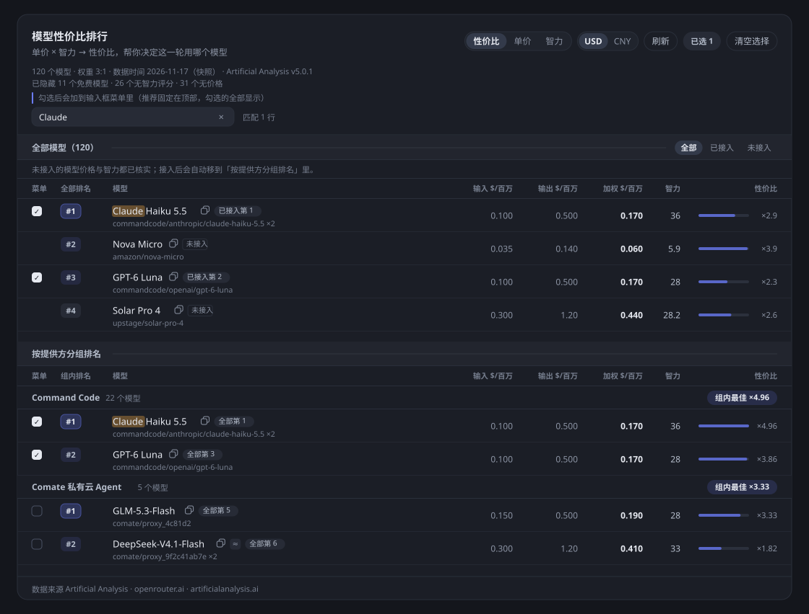

# 模型性价比 / Model value

按 **单价 × 智力** 给你当前接入的每个模型算一个性价比分数，在最需要做决定的地方——会话输入框的模型菜单——直接给出 top 3 推荐，一键切换。



## 它加了什么

- **模型菜单里的推荐**：打开模型菜单（`/model` 或点输入框的模型名），最上方多出一组推荐行，每行只有**名次 + 模型名 + 提供方胶囊**，点一下就把当前会话切过去。固定显示性价比 **Top 3**（三个不同模型）；你在面板里勾选的模型会全部追加在后面并标 ★。这组行的高度是固定的（列表约 4 行可见，超出的在块内滚动，标题右侧会显示「共 N 行 · 可滚动」），所以勾再多也不会把 DSH 原生菜单行挤变形。推荐永远在，勾选只是补充——不需要先去面板配置才能用。**菜单只回答"切到哪个渠道的哪个模型"**：提供方（`commandcode` / `comate ×2` 这种，同模型多渠道时带数量）直接显示在行尾，价格与智力留给排行面板，按钮上的「查看完整排行」一步就到。名字不再截断成省略号而是**换行**显示完整名字，所以整个菜单**没有 tooltip**——悬停既不可选中也不可复制，选择时也不该需要它。
- **完整排行面板**：从模型菜单最后一行的「查看完整排行」打开，一张可切换排序（性价比 / 单价 / 智力）与货币（USD / CNY）的明细表。表格分**上下两块**，共用一个滚动容器：
  1. **全部模型（N）**：已接入的渠道实例 + 未接入的市面模型，**一张榜、一套名次**。默认 `范围 = 全部`（两者都有）；标题条右侧的三个胶囊可收窄成「已接入」或「未接入」，标题跟着变成「已接入模型（N）」/「未接入模型（N）」，N 是当前可见的不同模型数。未接入的行没有勾选框，模型名旁边挂一个「未接入」小胶囊（**范围切到「未接入」时这个胶囊会隐藏**——标题已经是「未接入模型（N）」，每行再挂一遍只是复读），第二行显示它的模型 slug；它们价格与智力都已核实，接入后下次刷新会自动出现在「按提供方分组排名」里——这一块是**推导出来的**，不需要改数据或代码。
  2. **按提供方分组排名**：每个渠道一个小标题（渠道名 + 模型数 + 组内最佳性价比），组内按自己的 1..N 名次排列——"这个渠道上哪个最划算"和"整体哪个最划算"是两个问题。这一块始终只列已接入的渠道，不受第 1 块的「范围」影响。
  **名次的两种口径，两个都直接显示**：第 1 块的排名列是**全部名次** `allRank`（已接入 + 市面一起排，列头写明「全部排名」），每个已接入行的模型名后面还跟一个胶囊「已接入第 N」，也就是输入框菜单里那个名次；第 2 块的排名列是**组内名次**（列头「组内排名」），模型名后面跟胶囊「全部第 N」。两个数字都常驻可见，不靠悬停——悬停提示太容易漏看，而且同一模型在两个榜单里的 `#N` 本来就不一样，必须并排说清楚。同理，两块的性价比进度条各自按所在榜单的中位数归一（第 1 块用 `medianValueAll`，第 2 块用 `medianValue`），×倍数 只在同一块内可比。
  两块各自有一行**吸顶表头**，第 2 块的渠道小标题也吸顶——滚动时表头和分组头始终留在可见区域。表头是 `--dmv-cols` 定义的八列网格（勾选 / 排名 / 模型 / 输入 / 输出 / 加权 / 智力 / 性价比），表头与每一行共用同一份列宽，所以数字列始终对齐；货币单位只写在表头（`输入 $/百万`），不再在每行重复符号。行内层级也做了取舍：**输入 / 输出**淡化（只是背景信息），**加权单价**提亮（它就是排名依据），性价比列是进度条 + `×倍数`。只展示**同时有价格和智力分**的模型；免费、缺分、缺价的模型不占版面，但在表头上方用一行说明"已隐藏 X 个免费模型 · Y 个无智力评分 · Z 个无价格"。每行最左侧是"菜单"勾选框，**按渠道实例（提供方 + 模型）勾选**——同一个底层模型被多个提供方接入时各算一行，勾一个不会连带其他渠道；同一行会出现在两块里，勾选状态两处同步。表头控件区显示"已选 N"和"清空选择"。
  **按名搜索（只高亮，不过滤）**：表头下方有一个搜索框，按**模型名**做字面子串匹配（忽略大小写、正则元字符按字面处理）。命中部分在名字里用高亮底色标出，右侧显示「匹配 N 行」——**行数、顺序、名次、勾选状态都不变**，未命中的行也不会被隐藏或置灰。搜索是"找"不是"筛"，所以它可以和「范围」叠加：计数只统计第 1 块当前可见的行。
  **可复制**：面板里的文字都可以直接选中（`.dmv-panel` 显式声明 `user-select:text`，不依赖宿主默认值）；每个模型名后面还有一个复制按钮（两个小方块的图标，悬停变亮），点一下复制**完整模型名**——复制到的字符串与搜索框同一口径，粘进去必然命中。
  **模型的原始身份直接写在第二行**：模型格分两行——第一行是模型名 + 复制按钮 + ≈ 估算 + 名次胶囊 +（未接入时的）「未接入」胶囊，第二行是灰字的 `提供方/模型ID`，例如 `commandcode/anthropic/claude-haiku-5.5 ×2`；同一个模型被多渠道接入时末尾的 `×N` 说明这个渠道上有几个接入点指向同一个 id，市面模型没有渠道，第二行就是它的模型 slug（`anthropic/claude-fable-5.2`）。这行字以前是渠道胶囊的 tooltip：能看不能选、不能复制，截图里也看不见。现在它就是普通文本，可以选中复制、可以截图、也可以在搜索框里粘。**界面里不再有"只有悬停才知道"的信息**，剩下的 tooltip 只有复制按钮的状态提示和「×倍数 中位数」这类解释性说明。
  **模型格里的顺序是「名字 + 附属物」一体靠左**：模型名、复制按钮、≈ 估算、名次胶囊、「未接入」胶囊依次紧贴名字排列，空余宽度留在这一格的右侧，id 另起一行。早期版本让模型名 `flex:1 1 auto` 撑满整格，渠道胶囊就被挤到列末端，看起来像贴在输入单价旁边（`commandcode0.100`）；现在名字是 `flex:0 1 auto`，不会长距离甩开自己的胶囊。整格 `overflow:hidden`，极端窄的宽度下宁可裁掉胶囊末端，也不让内容压到价格列。
  **窄面板的退让顺序**：宽度不足时模型名与 id 各自省略——名字缩到省略号（`min-width:0` + `text-overflow:ellipsis`），id 行是一行 `nowrap` + 省略号（它可以被选中复制，所以省略号不影响拿到全文）；低于 900px 时「已接入第 N / 全部第 N」胶囊会隐藏（这两个名次仍分别在两块的名次列里），保证模型名优先可读。
- **给 Agent 用的工具**：`model_value_rank`，参数 `sort`、`limit`、`currency`、`weights`、`includeFree`、`market`、`refresh`。返回里 `rows` / `market` 的每一项都带 `allRank`（已接入 + 市面的统一名次）与 `allValueIndex`；工具自己的排序与 `limit` 仍按已接入的 `rank` 走，行为没变。

## 明暗主题

颜色全部来自 `--dsw-alias-*` 令牌，但"取哪个令牌、怎么用"有两处必须小心，否则深色主题下会花：

- **强调色只调色，不做底色**。有些主题的 `--dsw-alias-brand-primary` 是浅色（DSH 深色模式下就是偏白的强调色），所以 `#1` 徽章、组内最佳胶囊、性价比进度条都用 `color-mix(in srgb, var(--dsw-alias-brand-primary) N%, transparent)` 叠在行背景上，文字用 `--dsw-alias-label-primary`。这样品牌色是蓝是白都读得出来；反过来写成"实心品牌色 + `color:#fff`"，浅色品牌就会变成白底白字（0.4.2 的 `#1` 徽章就是这样消失的）。
- **勾选框自己画**。原生 `input[type=checkbox]` 在没声明 `color-scheme` 的深色页面上会画成白方块，和行为区不搭。现在 `appearance:none` + 自绘边框，选中时用 `--dsw-alias-label-primary` 填充、勾号用 `--dsw-alias-bg-base` 挖空，两种主题都成立。

`test/client.mjs` 把这两条写成了断言：所有 `background*` 里出现品牌色必须包在 `color-mix(` 里、样式表里不许出现硬编码白色文字、复位框必须 `appearance:none`。

## 分数怎么算

```
加权单价 = (输入 × (1 − 缓存命中率) + 缓存读 × 缓存命中率) × w_in + 输出 × w_out
性价比   = 智力分 ÷ 加权单价          （智力分 / 1 单位货币，越大越划算）
```

默认权重 `3:1`（偏编码），缓存命中率 `0.5`，都可在设置里改，也可以在请求里用 `?weights=1:1&cache=0.8` 覆盖。排名只对**同时有价格和智力分**的模型生效；免费、缺价格或缺分数的模型不进排行页，但会在表头如实统计被隐藏了多少个（接口和工具里仍然返回，只是面板不画）。

同一个模型被多个 provider 接入时**共用一个名次**，不占相邻位置；面板里每行的第二行写着 `提供方/模型ID`，同一渠道有多个接入点指向同一个 id 时末尾带 `×N`，N 是这一个模型的接入点数。菜单里的 Top 3 会跳过重复的模型，所以三行一定是三个不同的模型。组内名次同理：同一渠道里两个接入点指向同一个模型时也共用一个组内名次。

## 怎么把价格对上模型

同一个模型在不同 provider 里 id 完全不同，插件按三级匹配：**id 精确匹配** → **去掉 `:free` / `-free` / `-paid` 等后缀后匹配** → **按显示名匹配**（例如 Comate 把模型藏在 `proxy_<hash>` 后面，只能靠名字 `GLM-5.3 Flash` 对上 `z-ai/glm-5.3-flash`）。名字匹配取"最长匹配优先"，所以 `hy3` 抢不走 `hy3-preview` 的价格。带日期修订的 id（`qwen3.8-max-0902`、`ling-3.1-flash-1019`）两侧都按去掉 `-MMDD` 后比对，`-0902` 这样的月份日期才当日期，`glm-5` 这种名字里的数字不会被误删。

免费副本（`…-free`、`…:free`）一律按 0 价单独成组，即使价格表里只登记了付费版；表里完全没收录的免费模型也照样算免费，不会因为"查不到价"被当成未知。

## 数据从哪来

| 数据 | 来源 | 更新方式 |
| --- | --- | --- |
| 单价（USD / 1M tokens） | 随插件附带快照，**509 条键**（492 条 OpenRouter 报价镜像 + 17 条其他索引，另有 `tools/fill-gaps.mjs` 按目录 id 补齐的新模型） | 设置里打开在线刷新（默认开，24 小时 TTL），或用 `overridesJson` 手填 |
| 智力分 | Artificial Analysis Intelligence Index v5 快照，**176 个模型有分**（155 个 AA 实测 + 21 个按 HLE 折算） | 同 `overridesJson`，或 `node tools/sync-sources.mjs` |
| 模型清单 | 运行时 `llm.listModels()` | 实时，任何提供方增删模型立刻反映 |

两个同步脚本（都在 `tools/`，都用 `node` 跑）：

- `sync-sources.mjs` 从 [aiapiindex.com](https://aiapiindex.com) 的 public-data 清单拉两份镜像——Artificial Analysis 的完整榜单（2477 条记录，含每个推理档位）和 OpenRouter 的 727 条报价；另外读它自己的 105 行价格表拿 HLE 成绩。
- `fit-iq.mjs` 用两源都收录的 65 个模型拟合 `指数 ≈ a + b·HLE + c·HLE²`（R² 0.883，留一误差 5.2 分），系数写回 `sync-sources.mjs` 的 `IQ_FROM_HLE`。
- `fill-gaps.mjs` 针对镜像还没跟上、但本机已经在服务的新模型，直接问 OpenRouter 的 `/endpoints`，把主流档位价格补进快照。

关于诚实性：AA 打分过的模型用 AA 的数字；AA 没有、但 aiapiindex 测过 HLE 的新模型，用上面那条曲线折算，每条的 `note` 写明「按 HLE xx% 折算（拟合误差约 ±5）」，界面带 `≈`，悬停可见说明。传动档的推理档位（`-low`/`-high` 这类）不再各占一行，分数归到模型本身；同一模型换个吞吐档（`-fast`/`-highspeed`）则沿用父模型的数字并标 `≈`。两处都不覆盖已实测的数字。

市面模型和已接入模型用同一份 AA 镜像（`asOf 2026-11-17`），版本差已经消失。面板把它们放进同一张表（第 1 块，可按范围收窄），但**两套名次各算各的**：第 1 块是 `allRank`（两者一起排），第 2 块是渠道内名次；进度条也各按自己榜单的中位数归一。只有价格、没有分数的模型不进任何一张表（现在按 HLE 折算能覆盖大部分，剩下真正没有任何公开成绩的只在表头计数）。

在线刷新**只会更新已知模型的键**：一个新模型的报价不会因为抓取而被凭空创建（要补新模型就跑 `tools/fill-gaps.mjs`）。它只请求**在 OpenRouter 上确实有页面的那些键**；来自其他索引的模型（`source: "aiapiindex"`）没有 OpenRouter 页面，去问只会得到 404，所以不请求——之前每次刷新都会刷出十几条 404 警告，现在失败会合并成一行摘要（"在线价格：N 个模型刷新失败（… 等），继续使用快照价"），逐条明细留在 `failures` 字段里。

## 配置项

设置 → 插件 → 模型性价比：

| 字段 | 默认 | 说明 |
| --- | --- | --- |
| `weightInput` / `weightOutput` | 3 / 1 | 加权单价的输入/输出权重 |
| `cacheHitShare` | 0.5 | 估算里缓存读占输入的比例 |
| `currency` | USD | 默认展示货币 |
| `fx` | 7.2 | CNY 换算汇率 |
| `includeFree` | 开 | 接口与工具里是否返回免费模型（面板始终不画它们，只在表头统计个数） |
| `onlineRefresh` | 开 | 是否允许抓取在线报价（缓存 24 小时；`?refresh=1` 或面板的「刷新」会**等**这次抓取完成再返回） |
| `overridesJson` | 空 | 手填/覆盖价格与分数，见下 |

`overridesJson` 形如：

```json
{
  "models": { "vendor/model": { "input": 0.3, "output": 1.2, "cacheRead": 0.006 } },
  "scores": { "vendor/model": { "index": 42, "estimated": false, "note": "自测" } }
}
```

JSON 写坏了不会让插件崩：界面会显示一条警告，其余数据照常使用。

## HTTP 接口

面板与工具都读同一个 Host 端接口，可以自己 curl：

```
GET /dsh-model-value/api/rank?sort=value&currency=CNY&weights=3:1&cache=0.5&free=1&market=1&refresh=1
```

`sort` 取 `value`（默认）/ `price` / `iq`；`market=0` 不要市面那部分。返回 `{ ok, rows[], providers[], market[], selected[], counts, medianValue, medianValueAll, asOf, currency, weights, index, warnings }`——`rows` 是已接入的模型（每行带 `rank` 已接入名次、`groupRank` 组内名次、`allRank` 与已接入 + 市面一起排的名次、`allValueIndex` 相对 `medianValueAll` 的倍数），`providers` 是分组元信息（`{id, name, models, ranked, bestValue, bestIq}`，按组内最佳性价比排序），`market` 是未接入的模型（同样带 `allRank`/`allValueIndex`；它自己的 `rank` 仍是市面内部名次），`selected` 是当前勾选的渠道 id 数组。价与分的换算、排序、分组、并集名次都在 Host 上完成，客户端只负责渲染。

切换模型也走 Host：菜单里点一行，客户端 `POST` 一条 JSON 过去，由 Host 的 `sessionController` 真正改掉会话的模型。

```
POST /dsh-model-value/api/select
Content-Type: application/json
x-dsh-model-value: 1

{"sessionId":"session-…","provider":"orcarouter","model":"z-ai/glm-5.3-flash"}
```

返回 `{ok:true, value:{selected:{…}}}`，失败时是 `{ok:false, error:{code, message}}`，`code` 与 DSH 自己的 Remote 错误码一致（例如会话被另一个 DSH 实例占用时是 `session/writer-held`）。

为什么不在浏览器里直接调 `remote.session.selectModel`：`remote` 是 Harness 自己的客户端 Service，工作区里链接进来的第三方 bundle 拿不到它的命名空间（`ctx.remote` 在插件上下文里是 `undefined`，`ctx.inject(['remote'])` 也不会把它挂上）。Host 侧的 `sessionController` 才是真正做事的那一层，所以这一段放在 Host。

### 勾选模型（写入接口）

在排行面板每行勾选框点一下，会写入你的"已选模型"清单——勾选的模型**全部追加在模型菜单的 Top 3 之后**（带 ★，勾几个显示几个，超出菜单高度时内部滚动）。清单是**全局的**（不分会话），按**渠道实例**存储，即 `提供方/模型`（如 `commandcode/anthropic/claude-haiku-5.5`、`comate/proxy_c8cdb`），与切换模型时用的 `(provider, model)` 粒度一致。因此同一个底层模型被多个渠道接入时，勾一个**不会**连带其他渠道。

```
POST /dsh-model-value/api/pins
Content-Type: application/json
x-dsh-model-value: 1

{"keys":["commandcode/anthropic/claude-haiku-5.5","comate/proxy_c8cdb"]}
```

返回 `{ok:true, selected:[...]}`（去重、上限 100 条后的清单）。空数组 `{"keys":[]}` 即清空；清空后模型菜单只剩 Top 3 推荐。这个接口与 `/api/select` 用同一套本机守卫（自定义头 + Origin 校验，无用户级鉴权，仅本机单用户）。清单持久化在：

```
<DSH_HOME>/plugin-data/dsh-model-value/state.json
```

结构是 `{"pinnedKeys":[...]}`；写入用临时文件 + 原子重命名，只读环境下退化为内存态（重启后丢失，但不影响排行与切换）。

`GET /api/rank` 的返回里新增 `selected` 字段（当前勾选的渠道实例 id 数组），面板勾选态与模型菜单的 ★ 追加都读它，Agent 工具 `model_value_rank` 的结果里也带一份，但**不改变工具的排名与行内容**——工具始终给全量排行。

## 注意

- 单价指**每百万 token 的美元价**，不含订阅制、包月或按次计费的额度（例如某些 provider 的 credit 体系）；这些模型的 `blended` 只是相对参考。
- 价格表是随插件发布的快照，覆盖的是常见模型；没收录价格的模型不会出现在排行里（表头会统计"已隐藏 N 个无价格"），而不是猜一个价格。自己补价格用 `overridesJson`，或用 `?refresh=1` 走在线刷新。
- 智力分是一个综合基准，不等于你自己的任务表现；把它当筛选器，不要当结论。
- 勾选只影响插件自己注入到模型菜单里的那组行——**DSH 原生模型选择器自带的行不受影响**（插件无法重排或隐藏它们）。勾选按渠道实例区分，同一模型被多个提供方接入时会各占一行，勾哪个渠道就在菜单里显示哪个渠道；勾了几个就显示几行，行多时菜单内部滚动。
- 菜单里点一行切换时只改 `provider` 和 `model`，不传推理强度，所以会落到该模型的默认强度；需要特定强度就在原生的模型菜单里再选一次。
- 在线刷新依赖 `openrouter.ai` 可达；离线时继续使用快照，不会报错。
- `/dsh-model-value/api/rank` 由插件自己注册在 Web 服务上，**不带 DSH 的 API 鉴权**（DSH 的 `/api/*` 才有）；它只监听本机、只读、不返回任何凭据，但同机的其他进程可以直接 curl 到模型清单与价格。介意的话把插件关掉即可。
- `/dsh-model-value/api/select` 是**写操作**，所以加了两个门槛：请求必须带 `x-dsh-model-value: 1`（跨源页面发这个头会先触发预检，而本接口不响应预检），并且 `Origin` 存在时必须等于本服务的 origin。它仍然没有用户级鉴权——只适合本机单用户使用。

## 预览图

`docs/preview.svg` 由 `tools/preview.py` 画出（`python tools/preview.py out.png` 同时产出 PNG），输入框菜单预览由 `tools/preview_menu.py` 画出；两者生成的 `assets/screenshot-*.png` 通过根目录的 `screenshots.json` 声明给插件市场。脚本里写的是和样式表同一套几何：20px 边距、`--dmv-cols` 的八列轨道、34/28/32/38px 的条高，所以预览图和面板不会各画各的。面板本身的排列表现在 `client.js` 的 `CSS` 常量里，`test/client.mjs` 会校验"表头与每行都恰好有八列、`.dmv-grid` 真的是 grid、三层吸顶头的 z-index 递减"——0.4.1 就是因为少了第一条规则，八个单元格挤成了一行文字。
